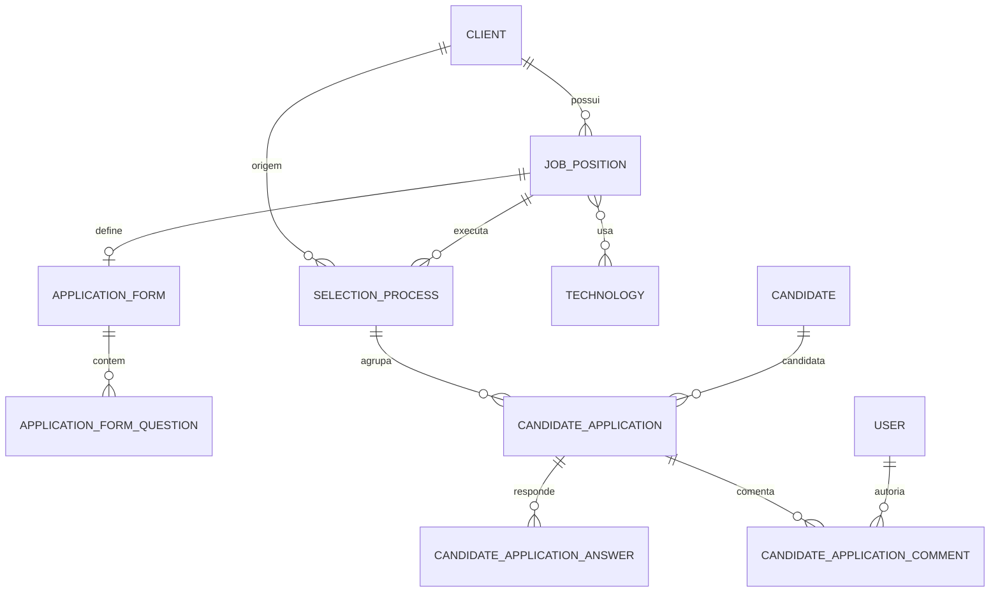

# Arquitetura — ATS TN Consultoria

Documento de referência da solução de ATS (Applicant Tracking System) da TN Consultoria. Cobre backend, frontend, modelo de dados, segurança, regras de negócio, endpoints e operação local.

## 1. Visão geral

O sistema permite gerir clientes, vagas, candidatos, processos seletivos e candidaturas. A partir da versão atual, o processo seletivo possui um **quadro Kanban** com as fases da candidatura, arrastando e soltando cards entre colunas, além de **comentários auditados** por candidatura.

Fluxo macro:

```text
Cliente -> Vaga -> Processo seletivo -> Candidaturas -> Kanban / Comentários
```

Principais capacidades:

- Cadastro de clientes, tecnologias, vagas e candidatos.
- Formulário de candidatura por vaga (perguntas configuráveis).
- Candidatura por vaga ou diretamente em um processo seletivo.
- Upload e download de currículo em PDF.
- Quadro Kanban por processo seletivo com 8 fases.
- Comentários por candidatura, com autor e data/hora.
- Autenticação por cookie HttpOnly, autorização por papéis e proteção CSRF.

## 2. Stack

### Backend (`consult.api`)

- Java 21
- Spring Boot 4.1.1
- Spring Web MVC
- Spring Security + JWT
- Spring Data JPA + Hibernate
- Flyway
- PostgreSQL (H2 nos testes)
- MapStruct
- Lombok
- Maven
- Armazenamento de currículos local ou S3-compatible (R2/MinIO/S3)

### Frontend (`ats-frontend`)

- Angular 17.3 (standalone components)
- TypeScript com `strictTemplates`
- Bootstrap 5.3 e Bootstrap Icons via CDN
- SCSS
- `@angular/cdk` (`DragDropModule` para o Kanban)
- RxJS

## 3. Estrutura do repositório

```text
ats-api-manager/
├── consult.api/
│   ├── src/main/java/com/br/ats/consult/api/
│   │   ├── applicationform/          # Formulários de candidatura por vaga
│   │   │   ├── domain/               # Modelos, enums, portas e casos de uso
│   │   │   └── infrastructure/       # Controller, DTOs, JPA, configurações
│   │   ├── candidate/                # Cadastro e busca de candidatos
│   │   ├── client/                   # Cadastro e busca de clientes
│   │   ├── job/                      # Vagas, localização, tecnologias e enums
│   │   ├── security/                 # Login, JWT, cookies, CSRF e rate limit
│   │   ├── selectionprocess/         # Processos, candidaturas, Kanban e comentários
│   │   ├── shared/                   # Erros de API, paginação e SPA forward
│   │   ├── technology/               # Catálogo de tecnologias
│   │   ├── Application.java
│   │   └── ServletInitializer.java
│   ├── src/main/resources/
│   │   ├── application.properties
│   │   ├── application-dev.properties
│   │   ├── application-prod.properties
│   │   └── db/migration/             # Flyway V1..V9
│   └── src/test/java/                # Testes de contexto, segurança e integração
├── ats-frontend/
│   └── src/
│       ├── app/
│       │   ├── core/                 # Guard, interceptor, modelos e utilitários
│       │   ├── features/             # application-form, candidate, client, home,
│       │   │                         # job-position, selection-process, technology
│       │   ├── pages/login/
│       │   ├── services/             # AuthService
│       │   ├── shared/
│       │   ├── app.config.ts
│       │   └── app.routes.ts
│       ├── environments/
│       └── index.html
├── docs/
│   └── arquitetura.md
└── postman/
    └── ats_collection.json
```

## 4. Arquitetura do backend

O backend segue arquitetura hexagonal (ports and adapters) por módulo de negócio.

```text
HTTP Request
    │
    ▼
Controller (adapter in/web)
    │  DTO + WebMapper
    ▼
Use Case (domain/usecase)
    │
    ▼
Gateway / Port (domain/port/out)
    │
    ▼
Repository Adapter (infrastructure/persistence/adapter)
    │  PersistenceMapper + Spring Data JPA
    ▼
PostgreSQL
```

Características:

- O domínio não depende de Spring Data nem de HTTP.
- Casos de uso são registados como beans nas classes `*UseCaseConfiguration`.
- DTOs web são convertidos por `*WebMapper` (MapStruct ou mapeamento explícito).
- Entidades JPA são convertidas por `*Mapper`.
- Exceções de domínio são traduzidas para respostas HTTP padronizadas em `ApiExceptionHandler`.
- Transações são declaradas nos casos de uso (`@Transactional`).
- `spring.jpa.open-in-view=false`: todo carregamento necessário deve acontecer dentro da transação.

### Módulos

| Módulo | Responsabilidade |
| --- | --- |
| `client` | Clientes, incluindo geração/validação de código e CNPJ |
| `candidate` | Candidatos, endereço e busca por nome/cargo |
| `technology` | Catálogo hierárquico de tecnologias |
| `job` | Vagas, vínculo obrigatório com cliente, localização, salários e tecnologias |
| `applicationform` | Formulário de perguntas por vaga e validação de respostas |
| `selectionprocess` | Processos seletivos, candidaturas, currículos, Kanban e comentários |
| `security` | Autenticação, autorização, JWT, cookies, CSRF e rate limiting |
| `shared` | Erros da API, paginação e roteamento SPA |

## 5. Modelo de dados



### Entidades principais

| Tabela | Descrição |
| --- | --- |
| `tb_clients` | Cliente com `name`, `cnpj` único e `code` único |
| `tb_candidates` | Candidato com e-mail único case-insensitive e endereço embutido |
| `tb_technologies` | Catálogo com categoria e hierarquia (`parent_id`) |
| `tb_job_positions` | Vaga com `client_id` obrigatório, status, modelo, contrato, faixa salarial e localização |
| `tb_job_position_technologies` | Relação N:N entre vaga e tecnologia |
| `tb_selection_processes` | Processo com cliente, vaga, status e data de abertura |
| `tb_candidate_applications` | Candidatura com currículo, `status` Kanban e data de aplicação |
| `tb_candidate_application_answers` | Respostas do formulário vinculadas à candidatura |
| `tb_candidate_application_comments` | Comentários com `author_id`, `author_email`, mensagem e data |
| `tb_application_forms` / `tb_application_form_questions` | Formulário ativo/inativo e perguntas por vaga |
| `tb_users` | Usuários com papel `ADMIN`, `TECH_RECRUITER` ou `USER` |

### Relacionamentos e restrições relevantes

- `tb_job_positions.client_id` é `NOT NULL` e referência `tb_clients`.
- `tb_selection_processes(client_id, job_position_id)` possui índice único parcial quando `status = 'OPEN'`.
- `tb_candidate_applications(selection_process_id, candidate_id)` é único.
- A candidatura pertence a um processo; o processo pertence a um cliente e a uma vaga.
- O status da candidatura é `VARCHAR(50)` com `CHECK` para os 8 valores do Kanban.
- Comentários são removidos em cascata quando a candidatura é removida.

### Migrações Flyway

| Versão | Conteúdo |
| --- | --- |
| `V1` | Tabela de tecnologias |
| `V2` | Tabela de vagas |
| `V3` | Tipo de contrato |
| `V4` | Escolaridade e inglês |
| `V5` | Usuários |
| `V6` | Endurecimento de usuários e vagas |
| `V7` | Clientes, candidatos, processos e candidaturas |
| `V8` | Formulários de candidatura |
| `V9` | Cliente obrigatório em vagas, status Kanban e comentários |

> A `V9` faz backfill de vagas antigas: cria `Cliente Padrão` se não existir cliente e associa as vagas sem `client_id` ao primeiro cliente disponível antes de aplicar `NOT NULL`.

## 6. Regras de negócio

### Cliente e vaga

- Toda vaga deve ter um cliente válido (`clientId` obrigatório e positivo).
- O cliente é resolvido no caso de uso de criação/atualização e persistido como `@ManyToOne`.
- A resposta da vaga inclui um resumo do cliente (`id`, `name`, `code`).

### Processo seletivo

- O processo exige `clientId` e `jobPositionId`.
- O cliente informado no processo deve ser exatamente o cliente da vaga; caso contrário, a operação é rejeitada.
- Se `status` não for informado, assume `OPEN`. Se `openedAt` não for informado, assume a data atual.
- Só é possível candidatar-se a um processo com status `OPEN`.

### Candidatura por vaga

- A vaga deve estar com status `OPEN`.
- A vaga deve possuir cliente associado.
- O sistema procura um processo `OPEN` do mesmo cliente e vaga; se não existir, cria um novo.
- O cliente da candidatura é sempre herdado da vaga — não há seleção manual de cliente no frontend.
- O candidato é reutilizado pelo e-mail (normalizado); os dados existentes são atualizados.
- Não é permitido o mesmo candidato duas vezes no mesmo processo.
- O currículo é obrigatório, deve ter assinatura `%PDF-`, extensão `.pdf` e respeitar o tamanho máximo configurado.
- Se o armazenamento do currículo falhar após o salvamento, o arquivo é removido.

### Formulário de candidatura

- O formulário é procurado pelo `jobPositionId`.
- Apenas formulários com `active = true` e com perguntas são aplicados.
- Perguntas obrigatórias sem resposta geram erro.
- Em `SINGLE_CHOICE`, a resposta deve pertencer às opções normalizadas da pergunta.
- Respostas vazias opcionais são ignoradas.
- As respostas armazenam também o enunciado e a posição da pergunta no momento da candidatura.

### Kanban

Fases disponíveis, na ordem exibida no quadro:

| Status | Rótulo | Cor | Ícone |
| --- | --- | --- | --- |
| `TRIAGEM` | Triagem | `#1d4ed8` | `bi-search` |
| `ENTRAR_EM_CONTATO` | Entrar em Contato | `#0e7490` | `bi-telephone` |
| `ENTREVISTA_TECH_RECRUITER` | Entrevista Tech Recruiter | `#6d28d9` | `bi-person-badge` |
| `APROVADO_ENTREVISTA_CLIENTE` | Aprovado para Entrevista Cliente | `#4338ca` | `bi-building` |
| `APROVADO_CLIENTE` | Aprovado pelo Cliente | `#15803d` | `bi-check-circle` |
| `REPROVADO` | Reprovado | `#b91c1c` | `bi-x-circle` |
| `DECLINOU` | Declinou | `#c2410c` | `bi-hand-thumbs-down` |
| `STAND_BY` | Stand By | `#475569` | `bi-pause-circle` |

- Toda candidatura inicia em `TRIAGEM`.
- O arrasto entre colunas chama `PATCH /api/v1/applications/{id}/status`.
- O backend aceita qualquer status válido do enum; não há máquina de estados restritiva.
- Em erro, o frontend reverte o card para a coluna anterior.
- A atualização do status exige papel `ADMIN` ou `TECH_RECRUITER`.

### Comentários

- Comentário exige autenticação.
- `message` é obrigatório e limitado a 2000 caracteres.
- O autor é extraído do usuário autenticado: `authorId` e `authorEmail`.
- Comentários são ordenados do mais recente para o mais antigo (`createdAt DESC`, `id DESC`).
- A listagem de comentários retorna 404 se a candidatura não existir.

## 7. API

Base: `/api/v1` (os endpoints de autenticação também existem sem o prefixo `/api/v1`).

Formato de erro padrão (`ApiError`):

```json
{
  "timestamp": "2026-10-25T14:00:00Z",
  "status": 400,
  "error": "Bad Request",
  "message": "O cliente da vaga é obrigatório",
  "path": "/api/v1/job-positions",
  "errors": [{ "field": "clientId", "message": "O cliente da vaga é obrigatório" }],
  "traceId": "..."
}
```

Paginação (`PageResponse`): `content`, `page`, `size`, `totalElements`, `totalPages`, `first`, `last`.

### Autenticação

| Método | Caminho | Acesso | Descrição |
| --- | --- | --- | --- |
| GET | `/auth/csrf` ou `/api/v1/auth/csrf` | Público | Gera cookie CSRF |
| POST | `/auth/login` ou `/api/v1/auth/login` | Público | Login; retorna `Set-Cookie: auth_token` |
| POST | `/auth/register` ou `/api/v1/auth/register` | Público | Registo com papel `USER`; retorna cookie e 201 |
| POST | `/auth/logout` ou `/api/v1/auth/logout` | Autenticado | Invalida token e limpa cookie |

### Clientes

| Método | Caminho | Acesso |
| --- | --- | --- |
| POST | `/api/v1/clients` | `ADMIN`, `TECH_RECRUITER` |
| GET | `/api/v1/clients` | Autenticado |
| GET | `/api/v1/clients/{id}` | Autenticado |

### Tecnologias

| Método | Caminho | Acesso |
| --- | --- | --- |
| POST | `/api/v1/technologies` | `ADMIN`, `TECH_RECRUITER` |
| GET | `/api/v1/technologies` | Autenticado |
| GET | `/api/v1/technologies/{id}` | Autenticado |
| GET | `/api/v1/technologies/parent/{parentId}` | Autenticado |

### Vagas

| Método | Caminho | Acesso | Observação |
| --- | --- | --- | --- |
| POST | `/api/v1/job-positions` | `ADMIN`, `TECH_RECRUITER` | Exige `clientId` |
| GET | `/api/v1/job-positions` | Autenticado | `technologyId`, `page`, `size`, `sort` |
| GET | `/api/v1/job-positions/{id}` | Autenticado | Inclui `client` |
| PUT | `/api/v1/job-positions/{id}` | `ADMIN`, `TECH_RECRUITER` | Exige `clientId` e `status` |
| DELETE | `/api/v1/job-positions/{id}` | `ADMIN`, `TECH_RECRUITER` | 204 |

### Candidatos

| Método | Caminho | Acesso | Observação |
| --- | --- | --- | --- |
| POST | `/api/v1/candidates` | `ADMIN`, `TECH_RECRUITER` | Cria ou atualiza por e-mail no fluxo de candidatura |
| GET | `/api/v1/candidates` | Autenticado | Filtros `name`, `role`; paginação |
| GET | `/api/v1/candidates/{id}` | Autenticado | |

### Processos seletivos

| Método | Caminho | Acesso | Observação |
| --- | --- | --- | --- |
| POST | `/api/v1/selection-processes` | `ADMIN`, `TECH_RECRUITER` | `clientId` deve ser o cliente da vaga |
| GET | `/api/v1/selection-processes` | Autenticado | Paginado; ordenação padrão `openedAt DESC` |
| GET | `/api/v1/selection-processes/{id}` | Autenticado | Inclui candidaturas, status, respostas e comentários |
| POST | `/api/v1/selection-processes/{id}/candidates` | `ADMIN`, `TECH_RECRUITER` | `multipart/form-data` |

### Candidaturas

| Método | Caminho | Acesso | Observação |
| --- | --- | --- | --- |
| POST | `/api/v1/job-positions/{jobId}/applications` | `ADMIN`, `TECH_RECRUITER` | Candidatura por vaga; herda o cliente |
| GET | `/api/v1/applications/{id}/resume` | Autenticado | Download do PDF |
| PATCH | `/api/v1/applications/{id}/status` | `ADMIN`, `TECH_RECRUITER` | Move no Kanban |
| GET | `/api/v1/applications/{id}/comments` | Autenticado | Mais recentes primeiro |
| POST | `/api/v1/applications/{id}/comments` | Autenticado | Autor vem do token |

#### Payload de candidatura (`multipart/form-data`)

| Parte | Tipo | Obrigatório |
| --- | --- | --- |
| `candidate` | JSON (`CandidateRequest`) | Sim |
| `resume` | Arquivo PDF | Sim |
| `answers` | JSON (`FormAnswersRequest`) | Não |

Exemplo de `candidate`:

```json
{
  "name": "Maria Silva",
  "age": 29,
  "role": "Backend Developer",
  "linkedinUrl": "https://www.linkedin.com/in/maria",
  "email": "maria@example.com",
  "phone": "+351912345678",
  "address": {
    "street": "Rua A",
    "number": "10",
    "complement": "",
    "neighborhood": "Centro",
    "city": "Lisboa",
    "state": "Lisboa",
    "zipCode": "1000-000",
    "country": "Portugal"
  }
}
```

Exemplo de `answers`:

```json
{
  "answers": [
    { "questionId": 1, "answer": "Sim" },
    { "questionId": 2, "answer": "5 anos" }
  ]
}
```

#### Status Kanban

```http
PATCH /api/v1/applications/42/status
Content-Type: application/json

{ "status": "ENTREVISTA_TECH_RECRUITER" }
```

#### Comentário

```http
POST /api/v1/applications/42/comments
Content-Type: application/json

{ "message": "Candidato com boa experiência em Java." }
```

### Formulário de candidatura

| Método | Caminho | Acesso |
| --- | --- | --- |
| GET | `/api/v1/job-positions/{jobId}/application-form` | Autenticado |
| PUT | `/api/v1/job-positions/{jobId}/application-form` | Autenticado |
| DELETE | `/api/v1/job-positions/{jobId}/application-form` | Autenticado |

> O `GET` retorna `204 No Content` quando a vaga não possui formulário.

## 8. Segurança

### Autenticação

- Login gera um JWT assinado e o envia em cookie `auth_token`:
  - `HttpOnly`
  - `SameSite=Strict` por padrão
  - `Secure` configurável
  - expiração padrão de 8 horas
- `JwtAuthenticationFilter` valida o cookie e também aceita `Authorization: Bearer <token>`.
- O token contém a versão do usuário; logout incrementa `token_version`, invalidando tokens anteriores.
- Sessão é `STATELESS`.

### Autorização

- Papéis: `ADMIN`, `TECH_RECRUITER`, `USER`.
- Escritas de clientes, tecnologias, vagas, candidatos e processos exigem `ADMIN` ou `TECH_RECRUITER`.
- Movimentação no Kanban (`PATCH`) exige `ADMIN` ou `TECH_RECRUITER`.
- Comentários podem ser criados por qualquer usuário autenticado.
- Leituras exigem autenticação; rotas de SPA e assets são públicas.

### CSRF

- Habilitado por padrão em produção (`CSRF_ENABLED=true`).
- Cookie `XSRF-TOKEN` (legível pelo JavaScript) deve ser enviado no header `X-XSRF-TOKEN`.
- O perfil `dev` desativa CSRF para facilitar o Angular em `localhost:4200`.

### CORS

- Origens configuráveis em `CORS_ALLOWED_ORIGINS` (padrão `http://localhost:4200`).
- Métodos permitidos: `GET`, `POST`, `PUT`, `PATCH`, `DELETE`, `OPTIONS`.
- `credentials` habilitado para envio do cookie de autenticação.

### Rate limiting

- Login: limite por IP e por conta.
- Registo: limite por IP e por conta.
- Configuração em `RATE_LIMIT_*`.
- Respostas excedentes retornam `429 Too Many Requests`.

## 9. Frontend

### Organização

- Componentes standalone, sem NgModules.
- Rotas em `app.routes.ts`.
- `AuthService` centraliza login, logout e estado do usuário.
- `auth.interceptor.ts` adiciona `withCredentials` e o header CSRF quando necessário.
- `auth.guard.ts` protege rotas autenticadas.
- Serviços por feature (`job-position.service.ts`, `selection-process.service.ts`, etc.) usam `environment.apiBaseUrl`.

### Módulo de processos seletivos

Componentes principais:

- `process-list`: lista e criação de processos; ao escolher a vaga, o cliente é preenchido automaticamente.
- `process-detail`: carrega o processo, formulário da vaga e candidaturas; integra Kanban e modais.
- `kanban-board`: quadro com 8 colunas, `cdkDrag`, `cdkDropListGroup`, preview/placeholder e emissão de `statusChanged` e `cardSelected`.
- `candidate-application-modal`: candidatura em vaga ou processo, upload de PDF e respostas do formulário.
- `application-detail-modal`: drawer com dados do candidato, currículo, respostas, histórico de comentários e novo comentário.

### Módulo de vagas

- O formulário de vaga exige o cliente, carregado via `ClientService`.
- A lista e o detalhe exibem o cliente associado.

### Estilo

- Bootstrap 5.3 e Bootstrap Icons carregados no `index.html`.
- O Kanban usa variáveis CSS por coluna (`--column-color`, `--column-soft`).
- Cards usam `border-left` colorido, avatar com inicial, contador de comentários e ações de detalhe.

## 10. Configuração e execução

### Backend

Variáveis relevantes:

| Variável | Padrão | Descrição |
| --- | --- | --- |
| `SPRING_PROFILES_ACTIVE` | — | `dev` ou `prod` |
| `PORT` | `8080` | Porta HTTP |
| `DB_URL` | `jdbc:postgresql://localhost:5432/ats_db` | Banco |
| `DB_USERNAME` / `DB_PASSWORD` | `postgres` / `postgres` | Credenciais |
| `JWT_SECRET` | — | Base64 com pelo menos 32 bytes; obrigatório |
| `JWT_EXPIRATION_MS` | `28800000` | Expiração do token |
| `COOKIE_SECURE` | `false` | Cookie apenas HTTPS |
| `COOKIE_SAME_SITE` | `Strict` | SameSite do cookie |
| `CSRF_ENABLED` | `true` | Habilita CSRF (dev desativa) |
| `CORS_ALLOWED_ORIGINS` | `http://localhost:4200` | Origens permitidas |
| `RESUME_MAX_SIZE_BYTES` | `10485760` | Tamanho máximo do PDF |
| `RESUME_STORAGE` | `local` | `local` ou `s3` |
| `RESUME_UPLOAD_DIR` | `uploads/resumes` | Diretório local |
| `RESUME_S3_*` | — | Configuração do storage S3-compatible |
| `APP_ADMIN_EMAIL` / `APP_ADMIN_PASSWORD` | vazio / vazio | Seed opcional de admin |

Comandos:

```bash
cd consult.api
mvn spring-boot:run -Dspring-boot.run.profiles=dev
mvn test
```

### Frontend

```bash
cd ats-frontend
npm install
npm start
npm run build
```

`environment.ts` aponta para `http://localhost:8080`. Em produção, `apiBaseUrl` é vazio (mesma origem).

## 11. Testes

- `ApplicationTests`: carregamento do contexto Spring.
- `SecurityAuthorizationTest`: autenticação, autorização por papel, CSRF, rate limit e validação de vaga com cliente.
- `CandidateSelectionProcessIntegrationTest`: candidatura por vaga/processo, currículo, formulário, busca, download, Kanban e comentários.

Comando:

```bash
cd consult.api
mvn test
```

## 12. Decisões e pontos de atenção

- O Kanban não impõe transições; qualquer fase pode ir para qualquer fase.
- A ordenação de comentários é garantida no caso de uso, independentemente da ordem do banco.
- A coleção de comentários na entidade JPA é `Set` para evitar `MultipleBagFetchException` ao buscar `answers` e `comments` juntos.
- A vaga antiga sem cliente é migrada para um cliente padrão na `V9`.
- O cadastro público cria usuários `USER`; para operar escritas é necessário um usuário `ADMIN` ou `TECH_RECRUITER`.
- Os endpoints de escrita do formulário de candidatura usam a regra fallback `/api/**` (apenas autenticado), diferente das demais escritas que exigem papel específico.
