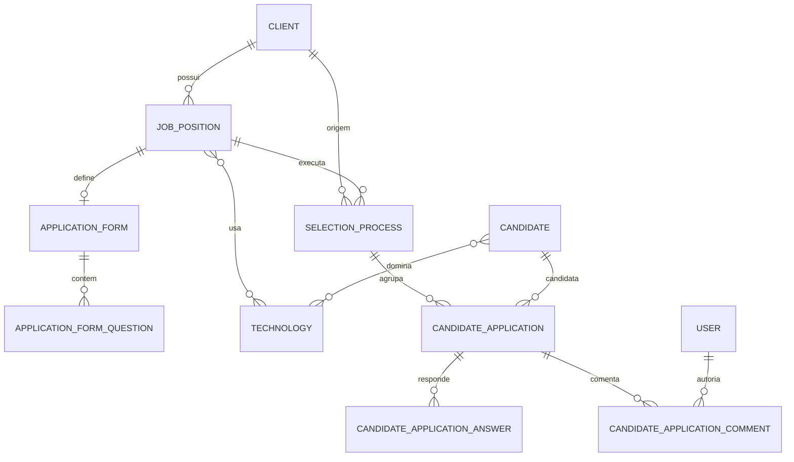

# Arquitetura — ATS TN Consultoria

Documento de referência da solução de ATS (Applicant Tracking System) da TN Consultoria. Cobre backend, frontend, modelo de dados, segurança, regras de negócio, endpoints e operação local.

## 1. Visão geral

O sistema permite gerir clientes, vagas, candidatos, processos seletivos e candidaturas. A partir da versão atual, o processo seletivo possui um **quadro Kanban** com as fases da candidatura, arrastando e soltando cards entre colunas, além de **comentários auditados** por candidatura.

Fluxo macro:

```text
Cliente -> Vaga -> Processo seletivo -> Candidaturas -> Kanban / Comentários
```

Principais capacidades:

- Cadastro de clientes, tecnologias, vagas e candidatos.
- Formulário de candidatura por vaga (perguntas configuráveis).
- Candidatura por vaga ou diretamente em um processo seletivo.
- Upload e download de currículo em PDF.
- Quadro Kanban por processo seletivo com 8 fases.
- Comentários por candidatura, com autor e data/hora.
- Autenticação por sessão opaca no servidor com cookie HttpOnly, autorização por papéis e proteção CSRF.

## 2. Stack

### Backend (`consult.api`)

- Java 21
- Spring Boot 4.1.1
- Spring Web MVC
- Spring Security + sessão opaca no servidor
- Spring Data JPA + Hibernate
- Flyway
- PostgreSQL (H2 nos testes)
- MapStruct
- Lombok
- Maven
- Armazenamento de currículos local ou S3-compatible (R2/MinIO/S3)

### Frontend (`ats-frontend`)

- Angular 17.3 (standalone components)
- TypeScript com `strictTemplates`
- Bootstrap 5.3 e Bootstrap Icons via CDN
- SCSS
- `@angular/cdk` (`DragDropModule` para o Kanban)
- RxJS

## 3. Estrutura do repositório

```text
ats-api-manager/
├── consult.api/
│   ├── src/main/java/com/br/ats/consult/api/
│   │   ├── applicationform/          # Formulários de candidatura por vaga
│   │   │   ├── domain/               # Modelos, enums, portas e casos de uso
│   │   │   └── infrastructure/       # Controller, DTOs, JPA, configurações
│   │   ├── candidate/                # Cadastro e busca de candidatos
│   │   ├── client/                   # Cadastro e busca de clientes
│   │   ├── job/                      # Vagas, localização, tecnologias e enums
│   │   ├── security/                 # Login, sessão, cookies, CSRF, rate limit e utilizadores
│   │   ├── selectionprocess/         # Processos, candidaturas, Kanban e comentários
│   │   ├── shared/                   # Erros de API, paginação e SPA forward
│   │   ├── technology/               # Catálogo de tecnologias
│   │   ├── Application.java
│   │   └── ServletInitializer.java
│   ├── src/main/resources/
│   │   ├── application.properties
│   │   ├── application-dev.properties
│   │   ├── application-prod.properties
│   │   └── db/migration/             # Flyway V1..V16
│   └── src/test/java/                # Testes de contexto, segurança e integração
├── ats-frontend/
│   └── src/
│       ├── app/
│       │   ├── core/                 # Guard, interceptor, modelos e utilitários
│       │   ├── features/             # application-form, candidate, client, home,
│       │   │                         # job-position, selection-process, technology, user
│       │   ├── pages/login/
│       │   ├── pages/register/       # Auto-cadastro público de candidato
│       │   ├── services/             # AuthService
│       │   ├── shared/
│       │   ├── app.config.ts
│       │   └── app.routes.ts
│       ├── environments/
│       └── index.html
├── docs/
│   └── arquitetura.md
└── postman/
    └── ats_collection.json
```

## 4. Arquitetura do backend

O backend segue arquitetura hexagonal (ports and adapters) por módulo de negócio.

```text
HTTP Request
    │
    ▼
Controller (adapter in/web)
    │  DTO + WebMapper
    ▼
Use Case (domain/usecase)
    │
    ▼
Gateway / Port (domain/port/out)
    │
    ▼
Repository Adapter (infrastructure/persistence/adapter)
    │  PersistenceMapper + Spring Data JPA
    ▼
PostgreSQL
```

Características:

- O domínio não depende de Spring Data nem de HTTP.
- Casos de uso são registados como beans nas classes `*UseCaseConfiguration`.
- DTOs web são convertidos por `*WebMapper` (MapStruct ou mapeamento explícito).
- Entidades JPA são convertidas por `*Mapper`.
- Exceções de domínio são traduzidas para respostas HTTP padronizadas em `ApiExceptionHandler`.
- Transações são declaradas nos casos de uso (`@Transactional`).
- `spring.jpa.open-in-view=false`: todo carregamento necessário deve acontecer dentro da transação.

### Módulos

| Módulo | Responsabilidade |
| --- | --- |
| `client` | Clientes, incluindo geração/validação de código e CNPJ |
| `candidate` | Candidatos, endereço e busca por nome/cargo |
| `technology` | Catálogo hierárquico de tecnologias |
| `job` | Vagas, vínculo obrigatório com cliente, localização, salários e tecnologias |
| `applicationform` | Formulário de perguntas por vaga e validação de respostas |
| `selectionprocess` | Processos seletivos, candidaturas, currículos, Kanban e comentários |
| `security` | Autenticação, autorização, sessão no servidor, cookies, CSRF e rate limiting |
| `shared` | Erros da API, paginação e roteamento SPA |

## 5. Modelo de dados



### Entidades principais

| Tabela | Descrição |
| --- | --- |
| `tb_clients` | Cliente com `name`, `cnpj` único e `code` único |
| `tb_candidates` | Candidato com e-mail único case-insensitive, endereço embutido e perfil (`education_level`, `english_level`) |
| `tb_candidate_technologies` | Relação N:N entre candidato e tecnologias dominadas |
| `tb_technologies` | Catálogo com categoria e hierarquia (`parent_id`) |
| `tb_job_positions` | Vaga com `client_id` obrigatório, status, modelo, contrato, faixa salarial e localização |
| `tb_job_position_technologies` | Relação N:N entre vaga e tecnologia |
| `tb_selection_processes` | Processo com cliente, vaga, status e data de abertura |
| `tb_candidate_applications` | Candidatura com currículo, `status` Kanban e data de aplicação |
| `tb_candidate_application_answers` | Respostas do formulário vinculadas à candidatura |
| `tb_candidate_application_comments` | Comentários com `author_id`, `author_email`, mensagem e data |
| `tb_application_forms` / `tb_application_form_questions` | Formulário ativo/inativo e perguntas por vaga, incluindo metadados do template (`question_key`, categoria, tecnologia pai, `max_selections`, `system_generated`) |
| `tb_users` | Utilizadores com `full_name`, e-mail único, hash BCrypt, papel `ADMIN`, `TECH_RECRUITER` ou `USER` e flag `enabled` |

### Relacionamentos e restrições relevantes

- `tb_job_positions.client_id` é `NOT NULL` e referência `tb_clients`.
- `tb_selection_processes(client_id, job_position_id)` possui índice único parcial quando `status = 'OPEN'`.
- `tb_candidate_applications(selection_process_id, candidate_id)` é único.
- A candidatura pertence a um processo; o processo pertence a um cliente e a uma vaga.
- O status da candidatura é `VARCHAR(50)` com `CHECK` para os 8 valores do Kanban.
- Comentários são removidos em cascata quando a candidatura é removida.
- `tb_candidate_technologies` usa chave primária composta (`candidate_id`, `technology_id`) e remove vínculos em cascata.
- Perguntas geradas usam `question_key` para identificar as perguntas padrão de identificação (`FULL_NAME`, `AGE`, `ROLE`, `EMAIL`, `PHONE`), os dados complementares (`LINKEDIN_URL`, `STREET`, `ADDRESS_NUMBER`, `COMPLEMENT`, `NEIGHBORHOOD`, `CITY`, `STATE`, `ZIP_CODE`, `COUNTRY`), a avaliação (`SALARY_EXPECTATION`, `WORK_MODEL`, `EDUCATION_LEVEL`, `ENGLISH_LEVEL`) e as perguntas de tecnologia (`TECH_CATEGORY_<CATEGORIA>` e `TECH_CHILDREN_<parentId>`).

### Migrações Flyway

| Versão | Conteúdo |
| --- | --- |
| `V1` | Tabela de tecnologias |
| `V2` | Tabela de vagas |
| `V3` | Tipo de contrato |
| `V4` | Escolaridade e inglês |
| `V5` | Usuários |
| `V6` | Endurecimento de usuários e vagas |
| `V7` | Clientes, candidatos, processos e candidaturas |
| `V8` | Formulários de candidatura |
| `V9` | Cliente obrigatório em vagas, status Kanban e comentários |
| `V10` | Remoção do controle de versão de token de usuário |
| `V11` | Perfil do candidato, tecnologias do candidato e metadados das perguntas do formulário |
| `V12` | Catálogo ampliado de linguagens, frameworks e cloud; nova categoria de versionamento |
| `V13` | Permite `VERSION_CONTROL` nas perguntas de tecnologia do formulário |
| `V14` | Guarda a chave da pergunta nas respostas para tradução no frontend |
| `V15` | Consentimento LGPD nas candidaturas (aceite, data/hora, versão e IP) |
| `V16` | Nome completo (`full_name`) dos utilizadores |

> A `V9` faz backfill de vagas antigas: cria `Cliente Padrão` se não existir cliente e associa as vagas sem `client_id` ao primeiro cliente disponível antes de aplicar `NOT NULL`.

## 6. Regras de negócio

### Cliente e vaga

- Toda vaga deve ter um cliente válido (`clientId` obrigatório e positivo).
- O cliente é resolvido no caso de uso de criação/atualização e persistido como `@ManyToOne`.
- A resposta da vaga inclui um resumo do cliente (`id`, `name`, `code`).

### Perfil do candidato

- `educationLevel` e `englishLevel` são opcionais e usam os enums `EducationLevelEnum` e `EnglishLevelEnum`.
- `technologyIds` referencia tecnologias existentes do catálogo (até 100); IDs inexistentes geram `404 TechnologyNotFoundException`.
- A resposta do candidato inclui as tecnologias resolvidas (`id`, `name`, `category`, `parentId`).
- No `PUT /api/v1/candidates/{id}`, os campos de perfil enviados substituem os anteriores; campos de perfil omitidos são limpos.
- No fluxo de candidatura, o perfil é enriquecido com as respostas de identificação (`FULL_NAME`, `AGE`, `ROLE`, `EMAIL`, `PHONE`), LinkedIn, endereço, formação, inglês e tecnologias, sem duplicar tecnologias.

### Contas e hierarquia de perfis

O sistema tem três perfis, do menor para o maior nível de privilégio:

| Papel técnico | Rótulo na interface | Capacidades |
| --- | --- | --- |
| `USER` | Candidato | Auto-cadastro público; pode consultar vagas, abrir o formulário de candidatura e candidatar-se. Não acede a clientes, candidatos, processos, comentários, gestão de vagas nem gestão de utilizadores |
| `TECH_RECRUITER` | Tech Recruiter | Gestão de clientes, tecnologias, vagas, candidatos, processos, Kanban e utilizadores |
| `ADMIN` | Administrador | Todas as capacidades do `TECH_RECRUITER`, incluindo governação de contas |

Regras de criação de conta:

- `POST /api/v1/auth/register` é público e **força `USER` no backend**. O DTO público não possui o campo `role`; qualquer `role` enviado no JSON é ignorado pelo Jackson e nunca chega ao serviço.
- `POST /api/v1/admin/users` é privado e exige sessão válida com `ADMIN` ou `TECH_RECRUITER`. Apenas este fluxo permite escolher explicitamente `ADMIN`, `TECH_RECRUITER` ou `USER`.
- `GET /api/v1/admin/users` lista as contas e também exige `ADMIN` ou `TECH_RECRUITER`.
- O e-mail é normalizado para minúsculas antes da verificação de duplicidade e da gravação; a base mantém a restrição `UNIQUE`.
- Todas as palavras-passe são guardadas com `BCryptPasswordEncoder`; nunca são devolvidas pela API.
- A senha deve ter entre 8 e 72 caracteres e conter maiúscula, minúscula, número e caractere especial.
- O nome completo é obrigatório no auto-cadastro e no cadastro administrativo (3 a 150 caracteres).
- O auto-cadastro público pode ser desativado em produção com `REGISTRATION_ENABLED=false`; o cadastro administrativo continua disponível para os perfis autorizados.

### Processo seletivo

- O processo exige `clientId` e `jobPositionId`.
- O cliente informado no processo deve ser exatamente o cliente da vaga; caso contrário, a operação é rejeitada.
- Se `status` não for informado, assume `OPEN`. Se `openedAt` não for informado, assume a data atual.
- Só é possível candidatar-se a um processo com status `OPEN`.

### Aderência do candidato à vaga

- Cada candidatura no processo recebe `adherence`, calculada a partir das respostas do formulário, do perfil do candidato e dos requisitos da vaga.
- Critérios e pesos: tecnologias (35), pretensão salarial (20), modelo de trabalho (15), formação (15) e inglês (15).
- Critérios sem requisito na vaga são ignorados e os pesos restantes são normalizados.
- O resultado contém `percentage` (0–100) e uma lista de `criteria` com `key`, `label`, `percentage`, `weight` e `detail`.
- A aderência é devolvida na consulta do processo, na candidatura por vaga/processo e no cartão do Kanban; a atualização de status mantém a aderência já carregada no frontend.

### Candidatura por vaga

- A vaga deve estar com status `OPEN`.
- A vaga deve possuir cliente associado.
- O sistema procura um processo `OPEN` do mesmo cliente e vaga; se não existir, cria um novo.
- O cliente da candidatura é sempre herdado da vaga — não há seleção manual de cliente no frontend.
- O candidato é reutilizado pelo e-mail (normalizado); os dados existentes são atualizados.
- Não é permitido o mesmo candidato duas vezes no mesmo processo.
- O envio exige aceite da Política de Privacidade (`consent.accepted=true` e `consent.version`).
- O servidor registra o aceite, a data/hora, a versão da política e o IP da requisição; o IP não é exposto na API.
- O currículo é obrigatório, deve ter assinatura `%PDF-`, extensão `.pdf` e respeitar o tamanho máximo configurado.
- Se o armazenamento do currículo falhar após o salvamento, o arquivo é removido.

### Formulário de candidatura

- O formulário é procurado pelo `jobPositionId`.
- Apenas formulários com `active = true` e com perguntas são aplicados.
- Se a vaga não tiver formulário ativo com perguntas, o template padrão é gerado automaticamente ao abrir a vaga ou ao receber uma candidatura.
- Perguntas obrigatórias sem resposta geram erro.
- Em `SINGLE_CHOICE`, a resposta deve pertencer às opções normalizadas da pergunta.
- Em `MULTIPLE_CHOICE`, as opções são separadas por `;`; todas devem pertencer à pergunta e o total não pode exceder `maxSelections`, quando definido.
- Respostas vazias opcionais são ignoradas.
- As respostas armazenam também a chave, o enunciado e a posição da pergunta no momento da candidatura.
- A criação de uma vaga gera automaticamente o formulário do template (identificação, dados complementares, avaliação e perguntas de tecnologias), que pode ser ajustado pelo recrutador ou regenerado.
- Existe um único formulário por vaga. O candidato preenche a identificação, os dados complementares, a avaliação e as tecnologias no mesmo formulário; o currículo e o consentimento LGPD permanecem etapas separadas.
- As perguntas essenciais `FULL_NAME`, `AGE`, `ROLE`, `EMAIL` e `PHONE` não podem ser removidas. Se um formulário antigo não as tiver, são acrescentadas automaticamente na consulta, no salvamento e na candidatura, preservando as perguntas personalizadas.
- Os dados de identificação do candidato são derivados das respostas do formulário; respostas de `STREET`, `ADDRESS_NUMBER`, `COMPLEMENT`, `NEIGHBORHOOD`, `CITY`, `STATE`, `ZIP_CODE` e `COUNTRY` preenchem o endereço.
- É gerada uma pergunta obrigatória de múltipla escolha por categoria de tecnologia existente no catálogo (por exemplo, linguagens, frameworks, cloud, bancos de dados e DevOps), mesmo que a vaga não exija tecnologias dessa categoria.
- As perguntas de categoria incluem todas as tecnologias do catálogo na categoria, permitindo selecionar mais de uma linguagem, framework, banco, etc.
- A opção `Não domino` é adicionada a todas as perguntas de tecnologia e é exclusiva em relação às restantes opções.
- As perguntas de tecnologia são obrigatórias e não podem ser removidas no editor. Formulários existentes sem as perguntas padrão recebem automaticamente as perguntas em falta na consulta ou no salvamento, tal como acontece com as perguntas essenciais.
- Respostas de `FULL_NAME`, `AGE`, `ROLE`, `EMAIL`, `PHONE`, `LINKEDIN_URL`, endereço, `EDUCATION_LEVEL`, `ENGLISH_LEVEL` e das perguntas de tecnologia enriquecem o perfil do candidato.
- Vagas antigas sem formulário recebem o template automaticamente na primeira consulta ou candidatura. Candidaturas antigas que foram registadas sem formulário não são preenchidas retroativamente.
- O botão **Restaurar padrão** no detalhe da vaga recria o template, preservando o ID do formulário existente.

### Kanban

Fases disponíveis, na ordem exibida no quadro:

| Status | Rótulo | Cor | Ícone |
| --- | --- | --- | --- |
| `TRIAGEM` | Triagem | `#1d4ed8` | `bi-search` |
| `ENTRAR_EM_CONTATO` | Entrar em Contato | `#0e7490` | `bi-telephone` |
| `ENTREVISTA_TECH_RECRUITER` | Entrevista Tech Recruiter | `#6d28d9` | `bi-person-badge` |
| `APROVADO_ENTREVISTA_CLIENTE` | Aprovado para Entrevista Cliente | `#4338ca` | `bi-building` |
| `APROVADO_CLIENTE` | Aprovado pelo Cliente | `#15803d` | `bi-check-circle` |
| `REPROVADO` | Reprovado | `#b91c1c` | `bi-x-circle` |
| `DECLINOU` | Declinou | `#c2410c` | `bi-hand-thumbs-down` |
| `STAND_BY` | Stand By | `#475569` | `bi-pause-circle` |

- Toda candidatura inicia em `TRIAGEM`.
- O arrasto entre colunas chama `PATCH /api/v1/applications/{id}/status`.
- O backend aceita qualquer status válido do enum; não há máquina de estados restritiva.
- Em erro, o frontend reverte o card para a coluna anterior.
- A atualização do status exige papel `ADMIN` ou `TECH_RECRUITER`.

### Comentários

- Comentário exige autenticação.
- `message` é obrigatório e limitado a 2000 caracteres.
- O autor é extraído do usuário autenticado: `authorId` e `authorEmail`.
- Comentários são ordenados do mais recente para o mais antigo (`createdAt DESC`, `id DESC`).
- A listagem de comentários retorna 404 se a candidatura não existir.

## 7. API

Base: `/api/v1` (os endpoints de autenticação também existem sem o prefixo `/api/v1`).

Formato de erro padrão (`ApiError`):

```json
{
  "timestamp": "2026-10-25T14:00:00Z",
  "status": 400,
  "error": "Bad Request",
  "message": "O cliente da vaga é obrigatório",
  "path": "/api/v1/job-positions",
  "errors": [{ "field": "clientId", "message": "O cliente da vaga é obrigatório" }],
  "traceId": "..."
}
```

Paginação (`PageResponse`): `content`, `page`, `size`, `totalElements`, `totalPages`, `first`, `last`.

### Autenticação

| Método | Caminho | Acesso | Descrição |
| --- | --- | --- | --- |
| GET | `/auth/csrf` ou `/api/v1/auth/csrf` | Público | Gera cookie CSRF |
| POST | `/auth/login` ou `/api/v1/auth/login` | Público | Login; cria sessão e retorna `Set-Cookie: ats_session` |
| GET | `/auth/me` ou `/api/v1/auth/me` | Autenticado | Valida a sessão e devolve `id`, `email` e `role` |
| POST | `/auth/register` ou `/api/v1/auth/register` | Público | Auto-cadastro com papel fixo `USER`; desativado em `prod` por padrão |
| POST | `/auth/logout` ou `/api/v1/auth/logout` | Autenticado | Invalida a sessão no servidor e limpa o cookie |

#### Auto-cadastro público (`RegisterCandidateDTO`)

`POST /api/v1/auth/register`

```json
{
  "name": "Maria Silva",
  "email": "maria@example.com",
  "password": "SenhaForte1!"
}
```

| Campo | Obrigatório | Validação |
| --- | --- | --- |
| `name` | Sim | 3 a 150 caracteres |
| `email` | Sim | formato de e-mail, até 255 caracteres, único |
| `password` | Sim | 8 a 72 caracteres, com maiúscula, minúscula, número e símbolo |

Resposta: `201 Created`. O papel atribuído é sempre `USER`, independentemente de qualquer campo extra no payload. O utilizador fica autenticado com sessão imediatamente após o registo.

#### Gestão de utilizadores (`CreateUserAdminDTO`)

| Método | Caminho | Acesso | Descrição |
| --- | --- | --- | --- |
| GET | `/api/v1/admin/users` | `ADMIN`, `TECH_RECRUITER` | Lista utilizadores com `id`, `name`, `email`, `role` e `enabled` |
| POST | `/api/v1/admin/users` | `ADMIN`, `TECH_RECRUITER` | Cria uma conta e permite escolher o papel |

`POST /api/v1/admin/users`

```json
{
  "name": "João Recrutador",
  "email": "joao@tnconsultoria.com",
  "password": "SenhaForte1!",
  "role": "TECH_RECRUITER"
}
```

| Campo | Obrigatório | Validação |
| --- | --- | --- |
| `name` | Sim | 3 a 150 caracteres |
| `email` | Sim | formato de e-mail, até 255 caracteres, único |
| `password` | Sim | 8 a 72 caracteres, com maiúscula, minúscula, número e símbolo |
| `role` | Sim | `ADMIN`, `TECH_RECRUITER` ou `USER` |

Resposta: `201 Created` com o utilizador criado. E-mail duplicado retorna `409 Conflict`; falta de autenticação retorna `401`; papel insuficiente retorna `403`.

### Clientes

| Método | Caminho | Acesso |
| --- | --- | --- |
| POST | `/api/v1/clients` | `ADMIN`, `TECH_RECRUITER` |
| GET | `/api/v1/clients` | `ADMIN`, `TECH_RECRUITER` |
| GET | `/api/v1/clients/{id}` | `ADMIN`, `TECH_RECRUITER` |

### Tecnologias

| Método | Caminho | Acesso |
| --- | --- | --- |
| POST | `/api/v1/technologies` | `ADMIN`, `TECH_RECRUITER` |
| GET | `/api/v1/technologies` | Autenticado |
| GET | `/api/v1/technologies/{id}` | Autenticado |
| GET | `/api/v1/technologies/parent/{parentId}` | Autenticado |

### Vagas

| Método | Caminho | Acesso | Observação |
| --- | --- | --- | --- |
| POST | `/api/v1/job-positions` | `ADMIN`, `TECH_RECRUITER` | Exige `clientId` |
| GET | `/api/v1/job-positions` | Autenticado | `technologyId`, `page`, `size`, `sort` |
| GET | `/api/v1/job-positions/{id}` | Autenticado | Inclui `client` |
| PUT | `/api/v1/job-positions/{id}` | `ADMIN`, `TECH_RECRUITER` | Exige `clientId` e `status` |
| DELETE | `/api/v1/job-positions/{id}` | `ADMIN`, `TECH_RECRUITER` | 204 |

### Candidatos

| Método | Caminho | Acesso | Observação |
| --- | --- | --- | --- |
| POST | `/api/v1/candidates` | `ADMIN`, `TECH_RECRUITER` | Cria ou atualiza por e-mail no fluxo de candidatura |
| PUT | `/api/v1/candidates/{id}` | `ADMIN`, `TECH_RECRUITER` | Atualiza dados e perfil do candidato |
| GET | `/api/v1/candidates` | `ADMIN`, `TECH_RECRUITER` | Filtros `name`, `role`; paginação |
| GET | `/api/v1/candidates/{id}` | `ADMIN`, `TECH_RECRUITER` | Inclui `educationLevel`, `englishLevel` e `technologies` |

### Processos seletivos

| Método | Caminho | Acesso | Observação |
| --- | --- | --- | --- |
| POST | `/api/v1/selection-processes` | `ADMIN`, `TECH_RECRUITER` | `clientId` deve ser o cliente da vaga |
| GET | `/api/v1/selection-processes` | `ADMIN`, `TECH_RECRUITER` | Paginado; ordenação padrão `openedAt DESC` |
| GET | `/api/v1/selection-processes/{id}` | `ADMIN`, `TECH_RECRUITER` | Inclui candidaturas, status, respostas e comentários |
| POST | `/api/v1/selection-processes/{id}/candidates` | `ADMIN`, `TECH_RECRUITER` | `multipart/form-data`; exige `consent` |

### Candidaturas

| Método | Caminho | Acesso | Observação |
| --- | --- | --- | --- |
| POST | `/api/v1/job-positions/{jobId}/applications` | Autenticado (`USER` incluso) | Candidatura por vaga; herda o cliente; exige `consent` |
| GET | `/api/v1/applications/{id}/resume` | `ADMIN`, `TECH_RECRUITER` | Download do PDF |
| PATCH | `/api/v1/applications/{id}/status` | `ADMIN`, `TECH_RECRUITER` | Move no Kanban |
| GET | `/api/v1/applications/{id}/comments` | `ADMIN`, `TECH_RECRUITER` | Mais recentes primeiro |
| POST | `/api/v1/applications/{id}/comments` | `ADMIN`, `TECH_RECRUITER` | Autor vem da sessão |

#### Payload de candidatura (`multipart/form-data`)

| Parte | Tipo | Obrigatório |
| --- | --- | --- |
| `candidate` | JSON (`CandidateRequest`) | Sim |
| `resume` | Arquivo PDF | Sim |
| `answers` | JSON (`FormAnswersRequest`) | Não |
| `consent` | JSON (`PrivacyConsentRequest`) | Sim |

Exemplo de `candidate`:

```json
{
  "name": "Maria Silva",
  "age": 29,
  "role": "Backend Developer",
  "linkedinUrl": "https://www.linkedin.com/in/maria",
  "email": "maria@example.com",
  "phone": "+351912345678",
  "educationLevel": "BACHELORS",
  "englishLevel": "ADVANCED",
  "technologyIds": [1, 2, 3],
  "address": {
    "street": "Rua A",
    "number": "10",
    "complement": "",
    "neighborhood": "Centro",
    "city": "Lisboa",
    "state": "Lisboa",
    "zipCode": "1000-000",
    "country": "Portugal"
  }
}
```

Exemplo de `answers`:

```json
{
  "answers": [
    { "questionId": 1, "answer": "Sim" },
    { "questionId": 2, "answer": "5 anos" }
  ]
}
```

Exemplo de `consent`:

```json
{
  "accepted": true,
  "version": "1.0"
}
```

A resposta da candidatura inclui `application.consent` com `accepted`, `acceptedAt` e `version`.

#### Status Kanban

```http
PATCH /api/v1/applications/42/status
Content-Type: application/json

{ "status": "ENTREVISTA_TECH_RECRUITER" }
```

#### Comentário

```http
POST /api/v1/applications/42/comments
Content-Type: application/json

{ "message": "Candidato com boa experiência em Java." }
```

### Formulário de candidatura

| Método | Caminho | Acesso |
| --- | --- | --- |
| GET | `/api/v1/job-positions/{jobId}/application-form` | Autenticado |
| PUT | `/api/v1/job-positions/{jobId}/application-form` | Autenticado |
| POST | `/api/v1/job-positions/{jobId}/application-form/generate` | `ADMIN`, `TECH_RECRUITER` |
| DELETE | `/api/v1/job-positions/{jobId}/application-form` | Autenticado |

> O `GET` devolve o formulário ativo e, quando a vaga não possui formulário ativo com perguntas, gera o template padrão antes de responder. O `POST /generate` recria as perguntas a partir do template da vaga (perguntas padrão + tecnologias) e preserva o ID do formulário existente.

Perguntas geradas expõem os metadados `questionKey`, `technologyCategory`, `parentTechnologyId`, `maxSelections` e `systemGenerated`.

## 8. Segurança

> O detalhe do login, sessão, CSRF, rate limit e fluxo no frontend está em [`fluxo-login.md`](./fluxo-login.md).

### Autenticação

> O projeto **não utiliza JWT**. A autenticação é feita por sessão opaca no servidor, conforme descrito em [`fluxo-login.md`](./fluxo-login.md). Os endpoints administrativos usam a mesma sessão dos restantes endpoints protegidos; a collection do Postman autentica-se pelo cookie `ats_session`, não por `Authorization: Bearer`.

- A autenticação usa uma sessão opaca no servidor; o navegador guarda apenas o ID de sessão no cookie `ats_session`:
  - `HttpOnly`
  - `Secure` obrigatório em produção
  - `SameSite=Strict` por padrão
  - sem `Max-Age`: é um cookie de sessão, descartado ao fechar o navegador
  - timeout de inatividade padrão de 30 minutos (`SESSION_TIMEOUT`)
- O tracking de sessão por URL está desativado; apenas cookie é aceito.
- A sessão é invalidada no logout e recriada com novo ID no login (proteção contra session fixation).
- O servidor mantém os dados da sessão em memória. Reiniciar a aplicação encerra todas as sessões; para múltiplas réplicas é necessário Spring Session com Redis/BD.
- O auto-registo público fica disponível em desenvolvimento, mas é desativado por padrão no perfil `prod` (`REGISTRATION_ENABLED=false`).

Fluxo de login:

1. O Angular obtém/renova o cookie CSRF em `GET /auth/csrf`.
2. O Angular envia `POST /auth/login` com `withCredentials` e o header `X-XSRF-TOKEN`.
3. O backend valida CSRF, aplica rate limit por IP e conta e autentica com BCrypt via `AuthenticationManager`.
4. O backend cria uma sessão opaca no servidor e envia o cookie `ats_session` `HttpOnly`.
5. O Angular chama `GET /auth/me` para validar a sessão e obter `id`, `email` e `role`, mantendo o estado em memória (signal), não em `localStorage`.
6. Em cada requisição, o Spring Security carrega o contexto de autenticação a partir da sessão.
7. Em `401`, o Angular limpa o estado local e redireciona para `/login`; o guard valida a sessão no backend antes de liberar rotas protegidas.
8. No logout, o backend invalida a sessão, limpa o cookie `ats_session` e descarta o contexto de segurança.
9. A sessão expira após 30 minutos sem atividade; fechar o navegador descarta o cookie de sessão.

### Autorização

- Papéis: `ADMIN`, `TECH_RECRUITER`, `USER` (candidato).
- `POST /auth/register` é público; o backend força `USER`.
- `/api/v1/admin/users` e `/api/v1/admin/users/**` exigem `ADMIN` ou `TECH_RECRUITER` tanto no `SecurityFilterChain` como em `@PreAuthorize` (defesa em profundidade).
- Escritas de clientes, tecnologias, vagas, candidatos, processos e formulários exigem `ADMIN` ou `TECH_RECRUITER`.
- Movimentação no Kanban (`PATCH`) exige `ADMIN` ou `TECH_RECRUITER`.
- Comentários de candidatura são de leitura e escrita exclusivas de `ADMIN`/`TECH_RECRUITER`.
- `USER` pode ler vagas e o formulário de candidatura e executar `POST /api/v1/job-positions/{jobId}/applications`; esta rota é a exceção de candidatura antes da regra genérica de escrita de vagas.
- `USER` recebe `403` em `GET /api/v1/clients/**`, `GET /api/v1/candidates/**`, `GET /api/v1/selection-processes/**` e `GET /api/v1/applications/**`, bem como em todas as escritas administrativas.
- As rotas de SPA e assets são públicas; a autorização efetiva ocorre nos guards do Angular e nos endpoints da API.

### CSRF

- Habilitado por padrão em produção (`CSRF_ENABLED=true`).
- Cookie `XSRF-TOKEN` (legível pelo JavaScript) deve ser enviado no header `X-XSRF-TOKEN`.
- O `csrf.interceptor.ts` garante o token em requisições `POST`, `PUT`, `PATCH` e `DELETE`, inclusive quando front e API estão em origens diferentes.
- O perfil `dev` desativa CSRF para facilitar o Angular em `localhost:4200`; a configuração é validada e não pode ser desativada em `prod`.

### CORS

- Origens configuráveis em `CORS_ALLOWED_ORIGINS` (padrão `http://localhost:4200`).
- Métodos permitidos: `GET`, `POST`, `PUT`, `PATCH`, `DELETE`, `OPTIONS`.
- `credentials` habilitado para envio do cookie de autenticação.

### Rate limiting

- Login: limite por IP e por conta; o contador da conta é limpo após sucesso.
- Registo: limite por IP e por conta (quando o auto-registo está habilitado).
- Configuração em `RATE_LIMIT_*`.
- O contador é em memória, por instância; em múltiplas réplicas é necessário um store compartilhado.
- Respostas excedentes retornam `429 Too Many Requests`.

### LGPD e consentimento

- A candidatura só é aceita com `consent.accepted=true` e `consent.version` preenchido.
- O backend valida o consentimento antes de guardar candidato, currículo ou candidatura.
- São registados `consent_accepted`, `consent_accepted_at`, `consent_version` e `consent_ip`; o IP não é devolvido pela API.
- A resposta da candidatura expõe `application.consent` com `accepted`, `acceptedAt` e `version`.
- A página pública `/privacidade` apresenta a versão atual da política (`PRIVACY_POLICY_VERSION`).
- Ao alterar o texto da política, a versão deve ser incrementada no frontend e a redação validada pelo jurídico.

## 9. Frontend

### Organização

- Componentes standalone, sem NgModules.
- Rotas em `app.routes.ts`.
- `AuthService` centraliza login, logout, `/auth/me` e o estado do usuário em um signal em memória.
- `csrf.interceptor.ts` obtém o cookie `XSRF-TOKEN` e injeta `X-XSRF-TOKEN` nas requisições mutáveis.
- `auth.interceptor.ts` adiciona `withCredentials` e limpa a sessão/redireciona em `401`.
- `auth.guard.ts` valida a sessão no backend via `/auth/me` antes de liberar rotas autenticadas.
- `role.guard.ts` valida o papel do utilizador em `route.data.roles`; `/jobs/new`, `/jobs/edit/:id`, `/candidates`, `/clients`, `/processes`, `/processes/:id` e `/users` exigem `ADMIN` ou `TECH_RECRUITER`.
- `AuthService.isStaff()` centraliza a verificação de `ADMIN`/`TECH_RECRUITER`; os menus e botões de gestão só são renderizados para esses perfis.
- O candidato (`USER`) vê apenas Home, Vagas e o detalhe da vaga com a ação **Candidatar-me**; criação/edição/exclusão de vagas, clientes, candidatos, processos e formulários não aparecem na interface.
- A rota `/privacidade` é pública para consulta antes do envio da candidatura.
- A rota `/register` é pública e apresenta o formulário de auto-cadastro de candidato (`USER`), sem seletor de papel.
- A rota `/users` é interna, com tabela de utilizadores e modal de criação que permite escolher `ADMIN`, `TECH_RECRUITER` ou `USER`.
- Serviços por feature (`job-position.service.ts`, `selection-process.service.ts`, etc.) usam `environment.apiBaseUrl`.

### Módulo de processos seletivos

Componentes principais:

- `process-list`: lista e criação de processos; ao escolher a vaga, o cliente é preenchido automaticamente.
- `process-detail`: carrega o processo, formulário da vaga e candidaturas; integra Kanban e modais.
- `kanban-board`: quadro com 8 colunas, `cdkDrag`, `cdkDropListGroup`, preview/placeholder, badge de aderência e emissão de `statusChanged` e `cardSelected`.
- `candidate-application-modal`: candidatura em vaga ou processo num único formulário, com identificação, dados complementares, avaliação e tecnologias; upload de PDF e aceite obrigatório da Política de Privacidade.
- `application-detail-modal`: drawer com dados do candidato, aderência à vaga, currículo, consentimento LGPD, respostas, histórico de comentários e novo comentário.
- `privacy-policy`: página pública (`/privacidade`) com a versão 1.0 da Política de Privacidade.

### Módulo de vagas

- O formulário de vaga exige o cliente, carregado via `ClientService`.
- A lista e o detalhe exibem o cliente associado.

### Estilo

- Bootstrap 5.3 e Bootstrap Icons carregados no `index.html`.
- O Kanban usa variáveis CSS por coluna (`--column-color`, `--column-soft`).
- Cabeçalhos das colunas e headers dos cards usam a cor da fase com texto branco.
- Cards usam avatar com inicial, contador de comentários e ações de detalhe.

## 10. Configuração e execução

### Backend

Variáveis relevantes:

| Variável | Padrão | Descrição |
| --- | --- | --- |
| `SPRING_PROFILES_ACTIVE` | — | `dev` ou `prod` |
| `PORT` | `8080` | Porta HTTP |
| `DB_URL` | `jdbc:postgresql://localhost:5432/ats_db` | Banco |
| `DB_USERNAME` / `DB_PASSWORD` | `postgres` / `postgres` | Credenciais |
| `SESSION_TIMEOUT` | `30m` | Timeout de inatividade da sessão |
| `SESSION_COOKIE_NAME` | `ats_session` | Nome do cookie de sessão |
| `COOKIE_SECURE` | `false` | Cookie apenas HTTPS |
| `COOKIE_SAME_SITE` | `Strict` | SameSite do cookie |
| `CSRF_ENABLED` | `true` | Habilita CSRF (dev desativa) |
| `REGISTRATION_ENABLED` | `true` (dev) / `false` (prod) | Permite auto-registo público |
| `CORS_ALLOWED_ORIGINS` | `http://localhost:4200` | Origens permitidas |
| `RESUME_MAX_SIZE_BYTES` | `10485760` | Tamanho máximo do PDF |
| `RESUME_STORAGE` | `local` | `local` ou `s3` |
| `RESUME_UPLOAD_DIR` | `uploads/resumes` | Diretório local |
| `RESUME_S3_*` | — | Configuração do storage S3-compatible |
| `APP_ADMIN_EMAIL` / `APP_ADMIN_PASSWORD` | vazio / vazio | Seed opcional de admin |

Comandos:

```bash
cd consult.api
mvn spring-boot:run -Dspring-boot.run.profiles=dev
mvn test
```

### Frontend

```bash
cd ats-frontend
npm install
npm start
npm run build
```

`environment.ts` aponta para `http://localhost:8080`. Em produção, `apiBaseUrl` é vazio (mesma origem).

## 11. Testes

- `ApplicationTests`: carregamento do contexto Spring.
- `SecurityAuthorizationTest`: autenticação, `/auth/me`, autorização por papel, CSRF, rate limit e validação de vaga com cliente.
- `UserManagementIntegrationTest`: auto-cadastro forçado para `USER`, rejeição de senha fraca, bloqueio de utilizadores anónimos/`USER` e criação/listagem administrativa por `ADMIN`/`TECH_RECRUITER`.
- `RegistrationDisabledTest`: garante que o auto-registo retorna 403 quando desativado.
- `CandidateSelectionProcessIntegrationTest`: candidatura por vaga/processo, currículo, formulário, busca, download, Kanban e comentários.

Comando:

```bash
cd consult.api
mvn test
```

## 12. Decisões e pontos de atenção

- O Kanban não impõe transições; qualquer fase pode ir para qualquer fase.
- A ordenação de comentários é garantida no caso de uso, independentemente da ordem do banco.
- A coleção de comentários na entidade JPA é `Set` para evitar `MultipleBagFetchException` ao buscar `answers` e `comments` juntos.
- A vaga antiga sem cliente é migrada para um cliente padrão na `V9`.
- O cadastro público cria usuários `USER` apenas quando `REGISTRATION_ENABLED=true`; em `prod` vem desativado. Para operar escritas é necessário um usuário `ADMIN` ou `TECH_RECRUITER`.
- O cadastro administrativo é o único fluxo que aceita um papel explícito; o DTO público não expõe `role`, e o serviço força `USER`.
- A aplicação mantém autenticação por sessão e não emite JWT; a collection do Postman usa cookies e CSRF, não `Bearer`.
- A sessão no frontend é validada por `/auth/me`; `localStorage` não é usado como prova de autenticação.
- O cookie de sessão é `HttpOnly` e o CSRF usa cookie separado `XSRF-TOKEN`, conforme o padrão double-submit do Spring Security.
- A sessão é mantida em memória no servidor; reinícios encerram sessões e múltiplas réplicas exigem store compartilhado (Spring Session/Redis).
- Os endpoints de escrita do formulário de candidatura usam a regra fallback `/api/**` (apenas autenticado), diferente das demais escritas que exigem papel específico.
