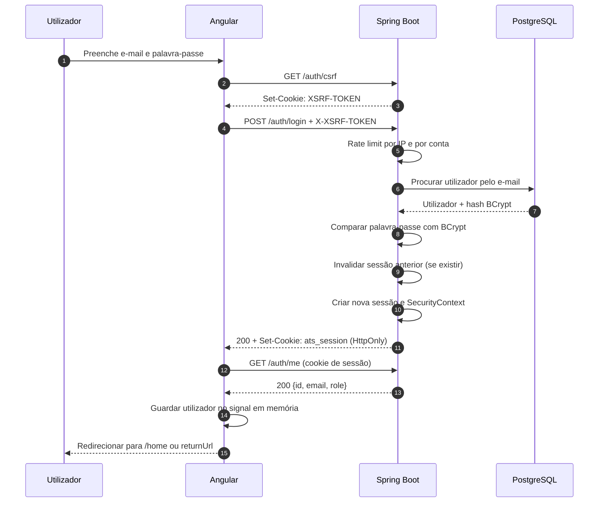

# Fluxo de login — ATS TN Consultoria

Documento dedicado a explicar como a autenticação funciona no ATS, do formulário Angular até a sessão no Spring Boot. Para a visão geral da arquitetura, consulte [`arquitetura.md`](./arquitetura.md). Para subir o ambiente local, consulte [`LOGIN_LOCAL.md`](../consult.api/LOGIN_LOCAL.md).

## 1. Resumo

O sistema **não usa JWT**. A autenticação é feita com uma **sessão opaca mantida no servidor**:

1. O Angular obtém um token CSRF.
2. O Angular envia e-mail e palavra-passe para `POST /auth/login` com o token CSRF.
3. O backend valida as credenciais com BCrypt.
4. O backend cria uma sessão nova no servidor e envia apenas o ID no cookie `ats_session` (`HttpOnly`).
5. O Angular confirma a sessão com `GET /auth/me` e guarda o utilizador em memória (signal).
6. Em cada requisição seguinte, o navegador envia o cookie e o Spring Security reconstrói a autenticação a partir da sessão.
7. No logout, a sessão é invalidada no servidor e o cookie é removido.

O navegador nunca recebe a palavra-passe nem um token de autenticação legível por JavaScript. O `localStorage` não é usado como prova de autenticação.

## 2. Componentes envolvidos

| Camada | Componente | Responsabilidade |
| --- | --- | --- |
| Frontend | `LoginComponent` | Formulário, validação, estado de envio, mensagens de erro e `returnUrl` |
| Frontend | `AuthService` | Chama CSRF, login, `/auth/me` e logout; mantém o signal `currentUser` |
| Frontend | `csrf.interceptor.ts` | Lê o cookie `XSRF-TOKEN` e envia `X-XSRF-TOKEN` em métodos mutáveis |
| Frontend | `credentialsInterceptor` | Adiciona `withCredentials` para enviar/receber cookies |
| Frontend | `authErrorInterceptor` | Em `401`, limpa a sessão local e redireciona para `/login` |
| Frontend | `authGuard` | Valida a sessão no backend antes de abrir rotas protegidas |
| Backend | `AuthController` | Expõe `/auth/csrf`, `/auth/login`, `/auth/register`, `/auth/me` e `/auth/logout` |
| Backend | `RateLimitService` | Limita tentativas por IP e por conta numa janela de tempo |
| Backend | `AuthenticationManager` | Autentica via `DaoAuthenticationProvider` |
| Backend | `UserDetailsServiceImpl` | Carrega o utilizador pelo e-mail normalizado |
| Backend | `UserPrincipal` | Representa o utilizador autenticado e as suas authorities |
| Backend | `SessionAuthenticationService` | Invalida a sessão anterior, cria o contexto e guarda-o na nova sessão |
| Backend | `SessionCookieService` | Limpa o cookie de sessão no logout |
| Backend | `SecurityAuthConfig` | CORS, CSRF, autorização, `SecurityContextRepository` e sessão `IF_REQUIRED` |

## 3. Endpoints de autenticação

Os endpoints existem em dois prefixos equivalentes: `/auth/...` e `/api/v1/auth/...`.

| Método | Caminho | Autenticação | CSRF | Descrição |
| --- | --- | --- | --- | --- |
| `GET` | `/auth/csrf` | Público | Não | Gera/renova o cookie `XSRF-TOKEN` |
| `POST` | `/auth/login` | Público | Sim | Valida credenciais e cria a sessão |
| `POST` | `/auth/register` | Público, se habilitado | Sim | Cria um `USER` e já cria a sessão |
| `GET` | `/auth/me` | Sessão válida | Não | Devolve `id`, `email` e `role` |
| `POST` | `/auth/logout` | Sessão válida | Sim | Invalida a sessão e limpa o cookie |

## 4. Cookies

### `ats_session`

Cookie de autenticação, configurado em `application.properties`:

| Atributo | Valor padrão | Observação |
| --- | --- | --- |
| Nome | `ats_session` | Configurável com `SESSION_COOKIE_NAME` |
| `HttpOnly` | `true` | Não é acessível por JavaScript |
| `Secure` | `false` em dev, `true` em prod | Em produção exige HTTPS |
| `SameSite` | `Strict` | Configurável com `COOKIE_SAME_SITE` |
| `Path` | `/` | Enviado para toda a aplicação |
| `Max-Age` | ausente | É um cookie de sessão; o navegador descarta ao fechar |
| Timeout no servidor | `30m` | Inatividade; configurável com `SESSION_TIMEOUT` |

O valor do cookie é apenas o **ID opaco da sessão**. Os dados do utilizador autenticado ficam no servidor.

### `XSRF-TOKEN`

Cookie separado, **legível por JavaScript**, usado no padrão double-submit do Spring Security. O Angular lê o valor e envia no cabeçalho `X-XSRF-TOKEN` em `POST`, `PUT`, `PATCH` e `DELETE`.

## 5. Fluxo de login



### 5.1. Passo a passo no frontend

1. O utilizador abre `/login`.
2. O `LoginComponent` valida o formulário: e-mail obrigatório e válido, palavra-passe obrigatória com pelo menos 6 caracteres.
3. `AuthService.login()` chama primeiro `GET /auth/csrf`.
4. O `csrf.interceptor.ts` lê o cookie `XSRF-TOKEN` e adiciona `X-XSRF-TOKEN` ao `POST /auth/login`.
5. O `credentialsInterceptor` garante `withCredentials: true`.
6. Depois do `200`, o `AuthService` chama `GET /auth/me` para confirmar que a sessão está ativa e obter `id`, `email` e `role`.
7. O utilizador é guardado no signal `currentUser`, apenas em memória.
8. O componente navega para `returnUrl` quando é um caminho interno seguro; caso contrário, vai para `/home`.
9. Enquanto a requisição decorre, o botão fica desabilitado com o texto “A entrar...”.
10. Em erro, a mensagem devolvida pela API é apresentada no formulário.

O `returnUrl` só é aceite se começar por `/` e não por `//`, evitando redirecionamentos para domínios externos.

### 5.2. Passo a passo no backend

1. `RateLimitService.check()` aplica o limite por IP (`50` tentativas por minuto por padrão).
2. O e-mail é normalizado com `trim().toLowerCase()`.
3. Aplica-se o limite por conta (`10` tentativas por minuto por padrão).
4. `AuthenticationManager` delega ao `DaoAuthenticationProvider`.
5. `UserDetailsServiceImpl` procura o utilizador no banco e devolve um `UserPrincipal`.
6. O `BCryptPasswordEncoder` compara a palavra-passe recebida com o hash guardado.
7. Utilizador inexistente, palavra-passe errada ou conta desabilitada resultam em `401` com “Credenciais inválidas”.
8. Em caso de sucesso, o contador da conta é limpo; o contador de IP continua a contar até a janela expirar.
9. `SessionAuthenticationService.establish()` invalida a sessão antiga, cria um novo `SecurityContext` e guarda-o na nova `HttpSession`.
10. A resposta é `200` com “Login efetuado com sucesso” e o cookie `ats_session`.

A invalidação da sessão anterior antes de criar a nova protege contra **session fixation**: um ID de sessão obtido antes do login deixa de ser válido após a autenticação.

## 6. Sessão nas requisições seguintes

O Spring Security usa `HttpSessionSecurityContextRepository`:

1. O navegador envia o cookie `ats_session`.
2. O servidor localiza a `HttpSession` correspondente.
3. O `SecurityContext` é carregado com o `UserPrincipal`.
4. As regras de autorização avaliam a role (`ADMIN`, `TECH_RECRUITER` ou `USER`).

A política de sessão é `IF_REQUIRED`: a sessão só é criada quando necessária. O tracking por URL está desativado; somente cookie é aceito.

Se a sessão não existir, tiver expirado ou tiver sido invalidada, a API responde `401` com “Autenticação necessária”.

## 7. Validação da sessão no frontend

Rotas protegidas usam o `authGuard`:

```text
Rota protegida
  -> AuthService.ensureSession()
     -> já existe currentUser? sim -> libera
     -> não -> GET /auth/me
        -> 200 -> guarda utilizador -> libera
        -> erro -> limpa estado -> redireciona para /login?returnUrl=...
```

Esse comportamento permite atualizar a página sem perder a sessão: o cookie continua no navegador e o `/auth/me` reconstrói o estado em memória.

O `authErrorInterceptor` também reage a `401` em chamadas normais: limpa o signal e envia o utilizador para `/login`, exceto nas próprias chamadas `/auth/*`.

## 8. Logout

```mermaid
sequenceDiagram
    autonumber
    participant A as Angular
    participant API as Spring Boot

    A->>API: POST /auth/logout + cookie + X-XSRF-TOKEN
    API->>API: Invalidar HttpSession
    API->>API: Limpar SecurityContext
    API-->>A: 200 + Set-Cookie: ats_session=; Max-Age=0
    A->>A: Limpar currentUser
    A-->>A: Navegar para /login
```

O logout no Angular limpa o estado local mesmo que a chamada ao backend falhe (`finalize`). No servidor, a sessão é invalidada e deixa de aceitar o ID anterior.

## 9. CSRF

- CSRF está habilitado por padrão (`CSRF_ENABLED=true`).
- O perfil `dev` desabilita CSRF para facilitar chamadas manuais; em `prod` é obrigatório.
- O Angular envia `X-XSRF-TOKEN` em todos os métodos mutáveis.
- Se o cookie `XSRF-TOKEN` ainda não existir, o interceptor faz `GET /auth/csrf` e repete a requisição.
- O próprio login é protegido por CSRF, apesar de ser um endpoint público.

## 10. Rate limiting

Os limites padrão ficam em `application.properties`:

| Chave | Padrão | Efeito |
| --- | --- | --- |
| `RATE_LIMIT_MAX_ATTEMPTS` | `10` | Tentativas por conta numa janela |
| `RATE_LIMIT_IP_MAX_ATTEMPTS` | `50` | Tentativas por IP numa janela |
| `RATE_LIMIT_WINDOW_SECONDS` | `60` | Tamanho da janela |
| `RATE_LIMIT_MAX_ENTRIES` | `50000` | Proteção contra crescimento excessivo do mapa |

Ao exceder o limite, a API responde `429 Too Many Requests` com `Retry-After`. Os contadores ficam em memória e são reiniciados quando a aplicação reinicia.

## 11. Registo

`POST /auth/register` segue o mesmo modelo de sessão:

1. Só funciona quando `REGISTRATION_ENABLED=true`.
2. Aplica rate limit por IP e por conta.
3. Normaliza o e-mail e verifica duplicidade.
4. Cria o utilizador com role `USER` e palavra-passe BCrypt.
5. Cria a sessão imediatamente.
6. Responde `201 Created`.

Em `prod`, o auto-registo vem desativado por padrão.

## 12. Respostas de erro relevantes

| Status | Situação | Mensagem típica |
| --- | --- | --- |
| `400` | E-mail/palavra-passe inválidos no payload | Erros de validação por campo |
| `401` | Credenciais inválidas ou sessão ausente/expirada | “Credenciais inválidas” / “Autenticação necessária” |
| `403` | CSRF inválido/ausente ou falta de permissão | “Acesso negado” |
| `429` | Limite de tentativas excedido | Mensagem com tempo de espera e `Retry-After` |

No login, o `401` é genérico de propósito: não revela se o e-mail existe.

## 13. Configuração e operação

### Variáveis principais

| Variável | Padrão | Descrição |
| --- | --- | --- |
| `SESSION_TIMEOUT` | `30m` | Inatividade máxima da sessão |
| `SESSION_COOKIE_NAME` | `ats_session` | Nome do cookie de sessão |
| `COOKIE_SECURE` | `false` em dev / `true` em prod | Exige HTTPS para o cookie |
| `COOKIE_SAME_SITE` | `Strict` | `Strict`, `Lax` ou `None` |
| `CSRF_ENABLED` | `true` | Habilita CSRF (dev desabilita) |
| `REGISTRATION_ENABLED` | `true` em dev / `false` em prod | Habilita auto-registo |
| `CORS_ALLOWED_ORIGINS` | `http://localhost:4200` | Origens com credenciais |

### Limitações atuais

- As sessões ficam **em memória**: reiniciar o backend encerra todos os logins.
- Com mais de uma réplica, cada instância teria sessões diferentes. Nesse cenário, use Spring Session com Redis ou banco.
- O rate limit também é local à instância.
- Em produção, `COOKIE_SECURE=true` e HTTPS são obrigatórios.
- Se frontend e API estiverem em domínios diferentes, use `COOKIE_SAME_SITE=None` com `COOKIE_SECURE=true` e configure `CORS_ALLOWED_ORIGINS`.

## 14. Teste rápido pela API

Com o backend em `dev` e CSRF desabilitado:

```bash
curl -i -c cookies.txt -X POST http://localhost:8080/api/v1/auth/login \
  -H 'Content-Type: application/json' \
  -d '{"email":"admin@tnconsultoria.com","password":"123456"}'

curl -b cookies.txt http://localhost:8080/api/v1/auth/me

curl -i -b cookies.txt -X POST http://localhost:8080/api/v1/auth/logout
```

Com CSRF habilitado, obtenha primeiro o cookie em `GET /api/v1/auth/csrf` e envie o valor no cabeçalho `X-XSRF-TOKEN` nos `POST`.

## 15. Referências no código

- `consult.api/src/main/java/com/br/ats/consult/api/security/AuthController.java`
- `consult.api/src/main/java/com/br/ats/consult/api/security/config/SecurityAuthConfig.java`
- `consult.api/src/main/java/com/br/ats/consult/api/security/service/SessionAuthenticationService.java`
- `consult.api/src/main/java/com/br/ats/consult/api/security/service/UserDetailsServiceImpl.java`
- `consult.api/src/main/java/com/br/ats/consult/api/security/model/UserPrincipal.java`
- `consult.api/src/main/java/com/br/ats/consult/api/security/RateLimitService.java`
- `consult.api/src/main/java/com/br/ats/consult/api/security/SessionCookieService.java`
- `ats-frontend/src/app/services/auth.service.ts`
- `ats-frontend/src/app/pages/login/login.component.ts`
- `ats-frontend/src/app/core/guards/auth.guard.ts`
- `ats-frontend/src/app/core/interceptors/csrf.interceptor.ts`
- `ats-frontend/src/app/core/interceptors/auth.interceptor.ts`
